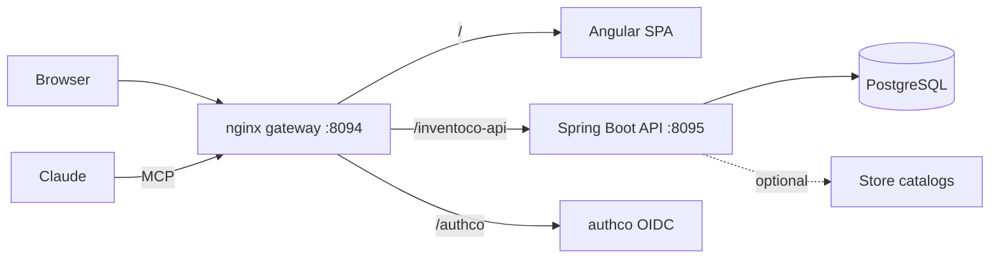

<div align="center">

# Inventoco

**Know what you have, what runs out next, and where it costs less.**

Inventory of anything (units, weight, volume, length, area) for households and small businesses,
with price history, depletion forecasts and an MCP server so Claude can keep it up to date.


</div>

---

## What it does

| | Feature | How |
|---|---|---|
| 📦 | **Any unit** | Count, mass, volume, length (meters of fabric, cable) and area. Stored in base units (unit, g, ml, mm, cm²). |
| 📉 | **Minimum stock + forecasts** | Predicts when each item runs out from recorded consumption, with LOW/MEDIUM/HIGH confidence. |
| 🏷️ | **Price history per supplier** | Compares prices per base unit, in the same currency, recent first. |
| 🛒 | **"What's missing" list** | Builds the shopping list with the cheapest supplier and turns it into a purchase. |
| 🤝 | **Anonymous public prices** | Opt-in sharing through a shared catalog. Public prices never reveal who recorded them. |
| 🏪 | **Store catalog ingest** | Optional daily refresh of Colombian chain prices (D1, Éxito, Carulla, Agro Fruver). |
| 🤖 | **MCP server** | Claude records consumption and answers "what do I need to buy?" in plain language. |

One SPA serves every user; each user only sees their own inventory.

## Architecture



The API follows a clean architecture split by layer and feature:

```text
src/main/java/com/lsoftware/inventoco/
├── entity/          # domain models and rules (units, package sizes, forecasts)
├── usecase/         # application use cases (record movement, ingest catalog, ...)
└── infrastructure/  # controllers, JPA repositories, MCP tools, store ingest
```

| Part | Path | Port |
| --- | --- | --- |
| API (Spring Boot 4, Java 25) | `src/` | 8095, path `/inventoco-api` |
| SPA (Angular 19) | `inventoco-app/` | dev server 4500 |
| Gateway (nginx: `/`, `/inventoco-api`, `/authco`) | `deploy/gateway/` | 8094 |
| MCP (Streamable HTTP, stateless) | `/inventoco-api/mcp` | through the gateway |

## Quick start

> [!NOTE]
> Postgres and the authco identity server are shared with other apps and run from a sibling
> `../platform` stack (database `inventoco`, role `inventoco`, SPA client `inventoco-app`).
> That stack is not part of this repository.

```sh
cp .env.example .env               # set PASSWORD_DB to the platform's inventoco password
(cd ../platform && docker compose up -d)
docker compose up -d --build       # open http://localhost:8094
```

Rebuild one service only: `docker compose up -d --build --no-deps inventoco-api`.

<details>
<summary>Environment variables</summary>

| Variable | Default | Purpose |
| --- | --- | --- |
| `PUBLIC_URL` | `http://localhost:8094` | Public origin of the gateway |
| `GATEWAY_PORT` | `8094` | Host port of the gateway |
| `USER_DB` / `PASSWORD_DB` | `inventoco` / — | Own role in the shared Postgres |
| `INGEST_ENABLED` | `false` | Daily refresh of store-chain prices |
| `INGEST_ON_START` | `false` | Run the ingest once on startup |

</details>

## Tests

No local JDK or Node is needed; both run in containers:

```sh
docker run --rm -v "$PWD":/app -v inventoco-gradle:/root/.gradle -w /app amazoncorretto:25-alpine ./gradlew test
(cd inventoco-app && docker run --rm -v "$PWD":/app -w /app node:22-alpine npx ng build)
```

## Connect Claude

In Claude, open **Settings → Connectors → Add custom connector** and use
`<PUBLIC_URL>/inventoco-api/mcp`. Sign in with the same account.

The tools cover the profile; items, consumption, purchases, counts and prices; suppliers and
public prices; and the forecast, shopping list, savings and best suppliers.

## Design

The SPA follows the Synapco design language with its own olive-black and lime palette
(`data-product="inventoco"` in `inventoco-app/src/styles.css`). It is bilingual (Spanish es-CO
and English). Product facts live in [`PRODUCT.md`](PRODUCT.md).
